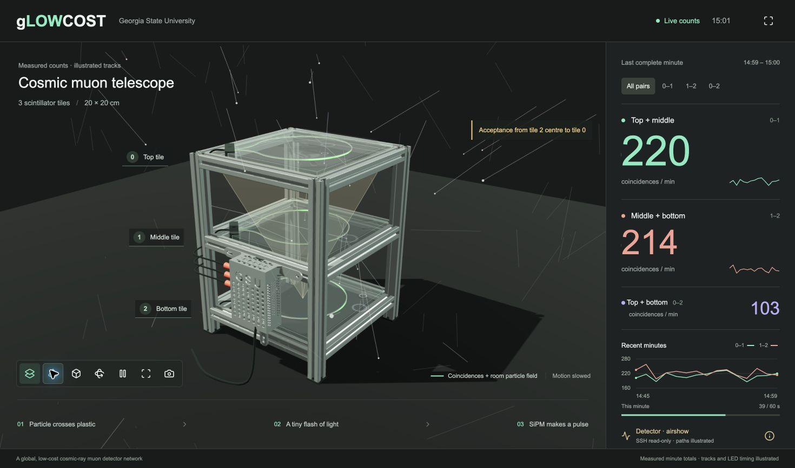
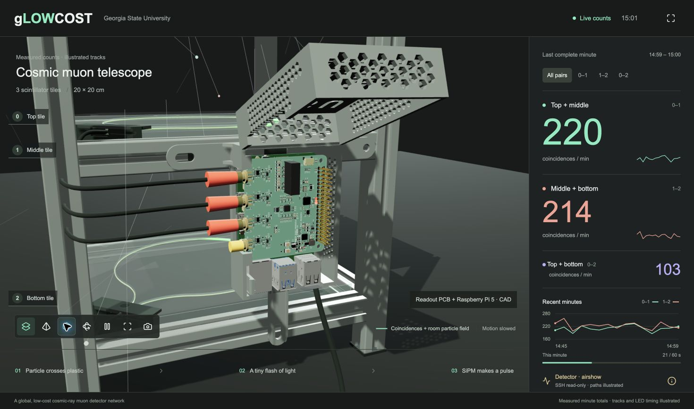

# gLOWCOST Digital Twin

This is an exhibition display for our three-tile cosmic muon detector. The
idea is to show what the detector does while people can also see the instrument
on the table. Particles move through the surrounding space, the tiles flash
when crossed, and the readout box can be opened to see the PCB and Raspberry Pi.

The numbers can come from the detector's latest minute file. The moving tracks
are an illustration. A minute file tells us how many coincidences were counted;
it does not tell us where each particle passed or when each LED flashed.



## Start the display

Install [Node.js](https://nodejs.org/) 20 or newer, then run:

```sh
git clone https://github.com/tharinduudu/digitalTwin.git
cd digitalTwin
node server.mjs
```

Open **http://127.0.0.1:8791/**. On a Mac, `start.command` does the same thing.
There is no npm install or build step. Three.js, the CAD models, and the other
assets are included, so simulation mode works without internet access.

Without a detector connection, the heading says **Simulation**. Each adjacent
pair averages about 230 counts per minute. Individual minutes fluctuate.

## What can be opened or changed?

- The layers button switches between wrapped and transparent tiles.
- The pyramid button shows the geometric acceptance for the selected pair.
- The box button opens the readout cover and moves the camera closer.
- The rotation button turns the detector slowly. Dragging also changes the view.
- Pause stops the animation, not the detector or the incoming minute records.
- The camera button shows a photograph of the physical detector.
- Full screen gives more room for an exhibition display.

Opening the readout loads the actual KiCad PCB export and Raspberry Pi 5 CAD.
The three indicators flash when the illustrated track crosses the corresponding
tile. These flashes are slowed down and are not a copy of the FPGA's LED logic.



## Use a detector's minute counts

The program only reads the log. It does not set bias, thresholds, GPIO modes,
or interrupt handlers. It does not start or stop acquisition.

First make sure normal SSH works. Replace `detector-address` with the address
of your Pi:

```sh
ssh cosmic@detector-address
```

With an existing SSH key, start the display like this:

```sh
DETECTOR_HOST=detector-address node server.mjs
```

For password login, open one reusable SSH connection first. Enter the password
at SSH's prompt, not in a script:

```sh
ssh -M -N -f -o ControlPersist=86400 \
  -S /tmp/glowcost-display-%C cosmic@detector-address
DETECTOR_HOST=detector-address node server.mjs
```

That connection lasts up to a day. The display checks the newest `.log` file
every 15 seconds and reads only its last 64 KiB. The Pi needs Python 3, but no
new Python packages. If the connection stops working, the last measurements
remain visible and the status changes. Fake counts are not substituted.

Optional settings:

| Variable | Default | What it changes |
| --- | --- | --- |
| `PORT` | `8791` | Local web server port |
| `DETECTOR_HOST` | unset | Enables measured-count mode |
| `DETECTOR_USER` | `cosmic` | SSH account |
| `DETECTOR_LOG_DIR` | `/home/cosmic/mppcInterface/firmware/libraries/slowControl` | Directory containing minute logs |
| `DETECTOR_CONTROL_PATH` | `/tmp/glowcost-display-%C` | Reusable SSH socket |

The expected column order is:

```text
coinc01, coinc02, coinc12, triple, single0, single1, single2, date and time
```

Check the acquisition code before using a different readout. Do not assume
that its second column is coincidence 1-2. Here it is coincidence 0-2.

The display shows the latest completed 60-second record and up to fifteen
recent records from that file. Its interval follows the file timestamp, which
need not land exactly on the wall-clock minute. Data more than 150 seconds old
is marked stale. A failed SSH read is shown as unavailable.

## How the model was made

The frame uses the supplied aluminium extrusion mesh. The unused fourth level
was removed, and the posts were shortened to the three-tile exhibition height.
The tiles are 20 x 20 x 1 cm, with 13 cm between their centre planes.

The tile and SiPM holder come from the supplied STL files. A section through
the groove is used to place an illustrative 1 mm fibre between the groove
walls. The acrylic outline, screw holes, slots, and engraving come from the
Illustrator file. The acrylic sheets and engraving are rotated 90 degrees
relative to the tile mesh. There is acrylic and a thin drawer-liner layer on
both sides of each tile. Their thicknesses are display assumptions, not
measurements taken from the artwork.

The Hamamatsu S13360-2050VE component model sits in the corner holder's
recess. Both ends of the fibre stop at its sensing face. Green light moves
along the fibre towards those ends after a tile crossing. The light is slowed
down so the process can be seen; it does not predict photon travel times or
the amount of light collected.

The readout cover and base come from the supplied enclosure STL. The readout
PCB is exported from KiCad, including its components. The Pi is Raspberry Pi's
own Pi 5 STEP model. See [the asset notes](docs/ASSETS.md) for sources,
dimensions, and instructions for making the browser files again.

The assembly explains the detector. It is not a clearance check for
manufacturing the enclosure. The Pi sits on the enclosure's four standoffs,
using the 49 x 58 mm mounting pattern. The readout's J2 socket is then aligned
to the Pi GPIO header using their CAD positions. The three SMA leads run inside the
vertical extrusion and leave it beside their connectors, not behind the box.

## How the particle animation works

Positions are sampled across a 120 x 120 cm horizontal area, rather than only
over the detector. Directions use a simple cosmic-muon angular model. Each
straight line is checked against all three tile planes. A miss produces no
tile flash. A single hit can flash one tile but cannot create a coincidence.

Unrelated tracks are thinned for drawing so the scene stays responsive. This
thinning does not change the simulation counters. The room field is still an
illustration, not a measured room flux or a particle-transport calculation.

The yellow acceptance shape is a **square pyramid from one reference point**:
the centre of the lower selected tile. Its upper boundary is the square upper
tile. It is not a circular cone, nor is it the acceptance for every possible
hit position. [The geometry notes](docs/GEOMETRY.md) explain this distinction.

The animation does not calculate energy deposition, light yield, scattering,
dark pulses, SiPM PDE, or real electronics timing. In live-count mode, none of
these illustrated intersections are added to the measured numbers.

## Find your way through the code

| File | Job |
| --- | --- |
| `server.mjs` | Serves the page and sends updates to browsers |
| `detector-source.mjs` | Reads and checks completed minute records over SSH |
| `simulation.mjs` | Generates straight tracks and simulated count bins |
| `public/app.js` | Connects the buttons, status, and incoming data |
| `public/scene.js` | Draws and animates the detector |
| `public/mechanics.js` | Places the supplied STL parts, acrylic, liner, and fibre |
| `public/fibre.js` | Follows the groove and animates green light towards the SiPM |
| `public/readout-placement.js` | Aligns the GPIO header and defines the side cable route |
| `public/hardware.js` | Loads the PCB and Pi CAD and flashes the indicators |
| `public/acceptance.js` | Defines the selected-pair acceptance geometry |
| `public/charts.js` | Draws the count history |
| `cad/prepare_parts.py` | Converts the mechanical files into display assets |
| `tests/` | Checks rates, column mapping, timestamps, and geometry |

The code uses ordinary JavaScript modules. Static CAD bodies with the same
appearance are merged after loading. The heavy PCB/Pi models load only when
the box is first opened. Rendering is capped near 30 frames per second,
and hidden tabs stop drawing.

## Tests

```sh
node --test tests/*.test.mjs
```

The tests check the target simulation rate, coincidence accounting, misses and
single hits, completed bins, log column order, timestamps, and square-pyramid
boundaries. See [verification notes](VERIFICATION.md) for browser checks.

Third-party CAD and libraries retain their own licences. No login credentials
or detector data files are included in this repository.
