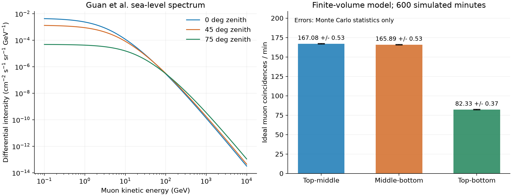

# Muon physics in the exhibition model

The first version was a geometric demonstration adjusted to about 230
adjacent coincidences per minute. That adjustment has been removed. The
current version uses an absolute cosmic-muon source and follows those muons
through the tile volumes. It is still an approximate transport model, not a
validated prediction of our indoor detector.

## Source

We use [Guan et al., arXiv:1509.06176](https://arxiv.org/abs/1509.06176),
Eqs. (2)-(3). It gives the joint energy and zenith-angle intensity at sea level.
Azimuth is uniform in the underlying incident field. No detector-rate scale
factor is fitted.

```text
c* = sqrt((c^2 + P1^2 + P2 c^P3 + P4 c^P5) / (1 + P1^2 + P2 + P4))
J(E,c) = 0.14 [E + 3.64/(c*)^1.29]^-2.7
         [1/(1 + 1.1 E c*/115) + 0.054/(1 + 1.1 E c*/850)]
P = [0.102573, -0.068287, 0.958633, 0.0407253, 0.817285]
```

`E` is kinetic energy in GeV in this implementation. This convention is used
in published applications of the same model, including
[He et al., Applied Sciences 12, 10975](https://doi.org/10.3390/app122110975).
`J` has units of cm^-2 s^-1 sr^-1 GeV^-1, with area perpendicular to the track.
We sample 0.1 GeV to 10 TeV, not an unbounded energy range. The low-energy
cut and the empirical source's accuracy are limitations, not measured errors.

## Projection and arrival times

For a face of area `A` with outward normal `n`, the incoming rate is:

```text
dR = J(E,c) A max(0, -n dot u) dE dc dphi
```

The surrounding box has width `W = 120 cm` and height `H = 62 cm`. For a
downward direction, its projected area is:

```text
Aprojected = W^2 c + W H sqrt(1-c^2) (|cos(phi)| + |sin(phi)|)
<Aprojected>phi = W^2 c + (4/pi) W H sqrt(1-c^2)
```

The code integrates `J * <Aprojected>` on a 160 x 96 grid in log-energy and
cosine. Bilinear cells are sampled continuously using a mixture of their four
linear corner basis functions. The log-energy Jacobian `E` is included.
Azimuth is then sampled conditional on the box's projected area, and a face
is selected from its projection weight. Positions are uniform on that face.
This boundary sampling does not make the underlying cosmic flux azimuthally
anisotropic.

The integral sets a Poisson arrival process. Waiting times are exponential:
`dt = -ln(1-U)/R`. They are not fixed intervals. There is no 230/min target.
Fifteen minutes are pre-simulated when the page opens to populate its history.

## Tile intersections and material

The active volumes are convex prisms from the supplied tile outline,
20 x 20 x 1 cm before the corner cut. We compute entry, exit and actual path
length, including side entries. Tiny fibre grooves are not removed from the
bulk material. The scintillator is treated as polystyrene.

Mean energy loss uses the [PDG polystyrene CSDA table](https://pdg.lbl.gov/2024/AtomicNuclearProperties/MUE/muE_polystyrene.txt).
For density `rho = 1.060 g/cm^3` and path length `L`:

```text
Rout = max(0, R(Tin) - rho L)
Tout = inverseRange(Rout)
deposited energy = Tin - Tout
```

Ranges and energies are log-interpolated. A muon stops if its remaining range
is shorter than the available material path. PDG warns that values below
10 MeV are unreliable. We use a simple continuous terminal-range approximation
there; it must not be used for precision stopping studies. Deposits are mean
CSDA losses, not sampled Landau/Vavilov pulse-height distributions.

We also use the Gaussian multiple-scattering core in
[PDG, Passage of Particles Through Matter, Eq. (34.16)](https://pdg.lbl.gov/2024/reviews/rpp2024-rev-passage-particles-matter.pdf):

```text
theta0 = 13.6 MeV/(beta p) sqrt(t) [1 + 0.038 ln(t/beta^2)]
t = L/X0, X0 = 41.31 cm for polystyrene
```

Two independent projected Gaussian deflections give an exit-direction kick.
Incrementing the cumulative variance avoids reapplying the logarithmic
correction separately to every thin layer. Energy changes are accounted for
approximately with the layer's mean momentum. This is a thin-slab treatment:
lateral displacement inside a tile and rare non-Gaussian scattering tails
are not reproduced.

Flight uses `beta = sqrt(1 - 1/gamma^2)` and `gamma = 1 + T/m_mu`. Proper
decay lifetime is sampled exponentially with mean 2196.9811 ns. A decayed
muon's track ends; its decay products are not transported. Within each thin
material crossing the incident beta is used for timing, so stopping-time
details are approximate. Display playback maps 2 ns to one second, a factor
of 500 million slower than physical flight. It does not change arrival rates.
Mass and lifetime use the [PDG muon listing](https://pdg.lbl.gov/2024/listings/rpp2024-list-muon.pdf).

## What is counted

A positive energy deposit is an ideal tile hit. The same muon hitting two
tiles contributes to that pair. A triple contributes to all three pairs.
There is no pulse threshold, photon collection, PDE, discriminator response,
electronic dead time or accidental-coincidence model. These numbers are
ideal muon coincidences, not a prediction of the readout's recorded counts.

The counters use every generated muon. Only unrelated room tracks are
thinned for drawing. Green fibre light and red indicator flashes explain
the detection sequence; they are not photon tracking or measured LED timing.

## Validation

Run:

```sh
node --test tests/*.test.mjs
node scripts/validate-physics.mjs
```

[The saved numerical check](physics-validation.json) contains 600 simulated
minutes with a fixed seed, per-pair statistical errors and minute-count Fano
factors. These errors describe the Monte Carlo only, not source uncertainty.
The tests also check numerical grid convergence, an analytic constant-flux
box, the projected angular law, generation-box invariance, cut-corner and
side intersections, energy conservation, stopping and subluminal flight.



The saved run gives 167.08 +/- 0.53, 165.89 +/- 0.53 and 82.33 +/- 0.37
coincidences/min for 01, 12 and 02 respectively. Doubling both integration
grids changes the horizontal source integral by 0.0077% and the boundary
arrival rate by 0.0316%. These small numerical differences do not establish
that the empirical flux or our detector response is known to that precision.

## Before comparing this with real data

The default is open sky at sea level. Our detector may be at a different
altitude and inside a building. The model does not transport through the
roof, aluminium frame, acrylic, cushioning, readout or supporting table.
It has no geomagnetic east-west effect, weather correction, correlated
air showers, secondary particles or measured detector efficiency.

Those inputs cannot be inferred from the appearance of the detector. A
quantitative response study should use the surveyed environment, measured
thresholds and efficiencies, and a validated transport tool such as Geant4.
Do not adjust this source until its result happens to match a measured rate.
